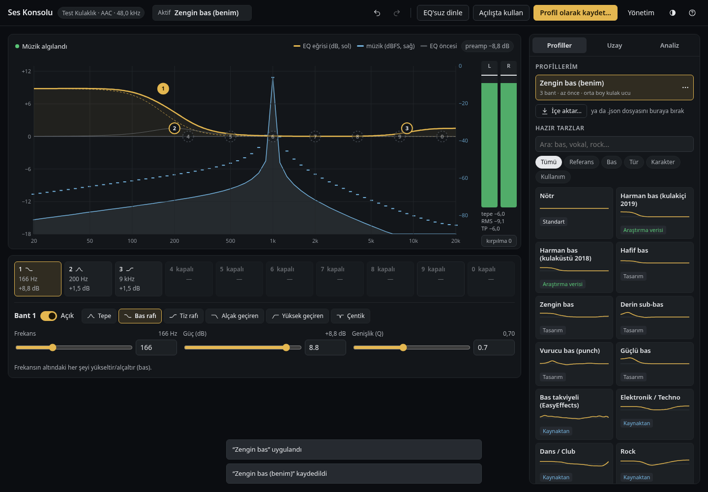
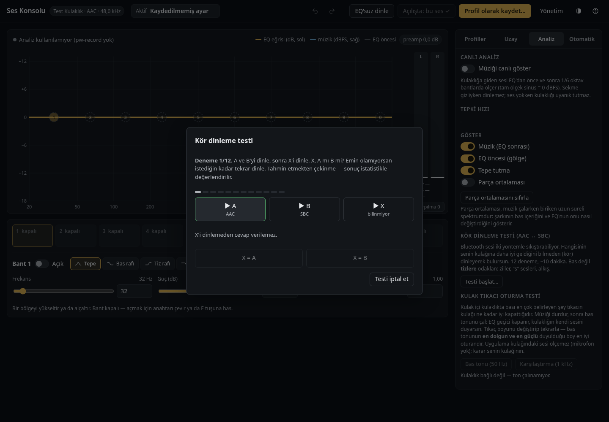
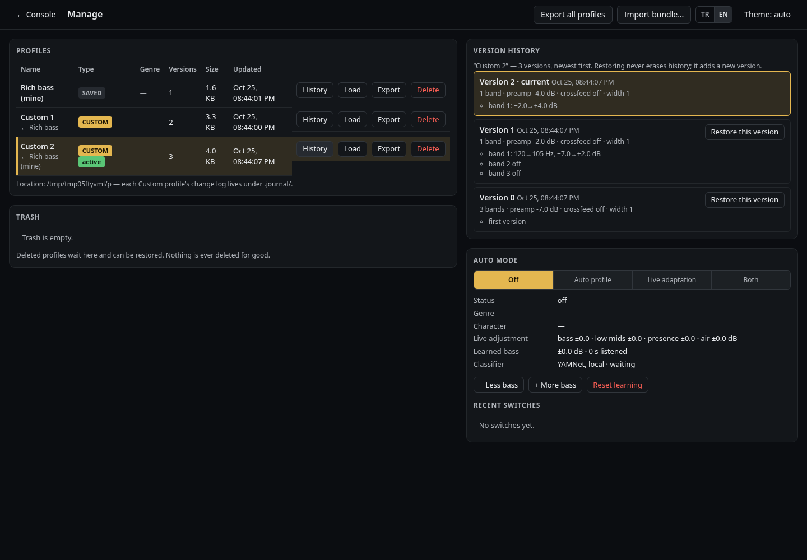
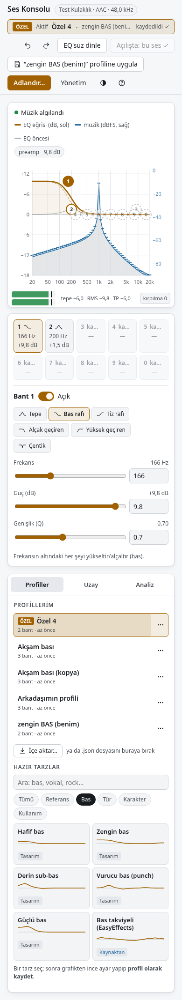

<p align="center"></p>

# bt-audio-hifi

[English](README.md) · **Türkçe**

Linux'ta (Fedora 44 · PipeWire 1.6.8 · WirePlumber 0.5.14) bir **Bluetooth kulaklığın** sesini ölçülebilir, geri
alınabilir ve kulağa göre en iyi hâle getiren araçlar: yüksek kalite profilde kalma, codec ölçümü, **profesyonel EQ
konsolu** (grafikten sürüklemeli 10 bant, uzay, 32 hazır tarz, canlı analizör), **dokunduğun an otomatik kaydedilen
çalışma kopyaları** (geri/ileri al), **müziği tanıyıp ayarı kendisi seçen otomatik mod**, yönetim sayfası.

Referans cihaz: Solix Nexus ANC (TWS, AAC/SBC). Başka Bluetooth kulaklıklarla da çalışır; hoparlör/HDMI/USB çıkışlarına
bilerek dokunmaz ([neden](docs/USER-DECISIONS.md#0-önce-kısa-cevap-bu-proje-tüm-çıkış-aygıtlarını-yönetir-mi)).

**Lisans: [MIT](LICENSE)** — herkes kullanabilir, değiştirebilir, dağıtabilir. Üçüncü taraf bileşenler: [NOTICE](NOTICE.md).

## Yol haritası — ne yapılırsa nereye ulaşılır

Yazılım tarafı (L2'nin üst kısmı ile L3–L6) sınıflarıyla ve durumlarıyla çıkarıldı. Kulaklığın içi (çip, DSP, DAC, ANC, TWS) ve radyo/protokol yığınının alt katmanları ise henüz ayrıştırılmadı — "donanımın potansiyelini tam kullanıyor muyuz" sorusunun cevabı en çok orada. Tablodaki kazançlar **beklentidir, ölçülmüş sonuç değildir**.

| katman | bugün bilinen (yapıldı) | yapılmadı · test edilmedi · bilinmiyor | yapılınca nereye ulaşılır | nasıl / kaynak |
|---|---|---|---|---|
| **L1a** akustik ve sürücü | Bas Harman hedefine yaklaştırıldı (105 Hz raf) | Kulaklığın frekans yanıtı ölçülmedi; bu modelin bilinen bir ölçümü yok. Orta ve tize hiç dokunulmuyor | **En büyük kazanç ihtimali:** her frekans hedefe çekilir — tüm frekansları düzgün duymak | Ucuz ölçüm mikrofonu + basit düzenek; ölçüm → parametrik EQ |
| **L1b** çip, firmware, DSP, DAC, amfi, ANC | Çip üreticisi belirlendi (Bluetrum, LMP'den); servis kanalı (SPP) bulundu, dinlemede 0 bayt | İç DSP zinciri, kendi ses limiti, firmware sürümü, iç EQ/bas takviyesi/sınırlayıcı var mı — bilinmiyor. Ayrı katman olarak hiç yazılmadı | İç işlem varsa bizim EQ ile üst üste binmesi önlenir, iki katman birlikte ayarlanır; belki ANC modu / iç EQ Linux'tan değiştirilir | Bluetrum SDK belgeleri ve kılavuzları; **önce yalnız okuma** — komut göndermek cihazı bozabilir |
| **L1c** TWS (iki kulaklık arası aktarım) | — | Hiç incelenmedi: ses ana tekliğe mi gidiyor, öbürüne nasıl aktarılıyor, gecikme ve kayıp | Kaliteden çok güvenilirlik: ~40 sn yeniden bağlanma beklemesi, teklikler arası gecikme, takılmalar | Bluetooth çekirdek spesifikasyonu + cihaz üzerinde ölçüm |
| **L2a** radyo ve LMP | AX210 adaptör, BlueZ 5.87, profil ve kopma davranışı | Radyo kaydı (btmon) hiç alınmadı (sudo gerekir); Wi-Fi ile çakışma ölçülmedi | SBC-XQ'nun neden paket kaybettiği görülür (sinyal mi, Wi-Fi mi); düzeltilebilirse SBC-XQ yeniden aday | `sudo bash tools/btmon-capture.sh 60` → `bta btmon-report` |
| **L2b** L2CAP ve AVDTP | Bağlantı kuruluyor, akış çalışıyor | Protokol durum makineleri belgelenmedi; MTU / paket boyutu / gecikme ölçülmedi | Takılma ve gecikmenin kaynağı ayrıştırılır | Bluetooth çekirdek spesifikasyonu + btmon kaydı |
| **L2c** A2DP ve codec | **Güçlü:** AAC ve SBC bayt bayt çözüldü, SBC-XQ ölçülüp elendi, kalite karşılaştırıldı; AAC ~17 kHz'de kesiyor | AAC ↔ SBC kararı kör ABX testini bekliyor; AAC'yi daha yüksek bit hızına zorlamak denenmedi | Codec seçimi kulağa göre verilir; belki AAC'nin üst frekans kesimi kalkar | `bta abx` (kör test, konsolda) |
| **L3–L6** Linux, PipeWire, bta, arayüz | **Ayrıntılı:** süreçler, graf, resampler, API, durum geçişleri | Küçük gri alanlar ([FEATURES](docs/FEATURES.md)) | — | `docs/layers/` |

**Aşılamayacak tavan.** Kulaklık yalnız SBC ve AAC destekliyor; LDAC/aptX hiçbir yazılımla gelmez. Aktarımın tavanı AirPods düzeyidir (AirPods da AAC kullanır); ötesi sürücünün fiziğidir. Gerçekçi hedef: AirPods kalitesinde aktarım + bu kulaklığa özel ölçülmüş düzeltme — pahalı kulaklıklara kulakla yaklaşabilir, fiziği değiştiremez.

**Açık kaynak tarafı.** Ucuz TWS kulaklıkların büyük kısmı Bluetrum çipli. Ölçüm yöntemi ve araçlar katman katman belgelenirse proje "bir kulaklığın ayarı" olmaktan çıkar, aynı sınıftaki başka kulaklık sahiplerinin de kullanabileceği bir yönteme dönüşür.

**Plan:** L1 ve L2 ayrı katmanlara bölünür, her biri aynı şablonla (seçenekler · durumlar · değişkenler · ölçüm yöntemi) doldurulur. Önerilen sıra: L1a (ölçüm) → L1b (salt okuma) → L2a (radyo kaydı).

- [ ] **L1a** akustik ve sürücü
- [ ] **L1b** çip, firmware, DSP, DAC, amfi ve ANC — en çok bilinmeyen burada
- [ ] **L1c** TWS aktarımı
- [ ] **L2a** radyo ve LMP
- [ ] **L2b** L2CAP ve AVDTP
- [ ] **L2c** A2DP ve codec

## Kim ne yapabilir — üretici ↔ kullanıcı

Bir kulaklığın sesini en iyi hâle getirmek için gereken bilginin bir kısmı **yalnız üreticide** vardır (fabrika ölçümü, firmware'deki işlem), bir kısmını ise **kullanıcı kendisi** ölçebilir. Aşağıdaki ayrım bu yüzden önemli: üretici paylaşmadıkça kullanıcı tahmin yürütür; kullanıcı ölçtükçe üreticinin söylemediği boşluk kapanır.

### Üreticinin paylaşması gereken veriler

| veri | neden önemli | standart / nasıl |
|---|---|---|
| Frekans yanıtı (ham ölçüm dosyası, farklı tıkaç oturmalarıyla) | Kulaklığa özel EQ düzeltmesinin tek sağlam temeli; bugün bu modelin hiç ölçümü yok | IEC 60318-4 kulak simülatörü (ör. GRAS 43AG / B&K 5128), CSV olarak |
| Firmware'deki işlem zinciri: iç EQ, bas takviyesi, sınırlayıcı / dinamik aralık sıkıştırma, mod başına (ANC açık / kapalı / şeffaf) | Bilinmezse kullanıcının EQ'su üreticininkiyle üst üste biner; bas "fazla" ya da "boğuk" çıkar | Mod başına yanıt eğrisi + işlem listesi |
| Codec ayrıntıları: AAC bit hızı ve VBR/CBR, SBC en yüksek bitpool, desteklenen örnekleme hızları | Aktarım kalitesinin tavanını belirler (bu kulaklıkta AAC ~17 kHz'de kesiyor) | A2DP yetenek tablosu |
| Ses seviyesi eşlemesi, en yüksek çıkış ve 94 dB SPL'de bozulma (THD) | Sınırlayıcının ne zaman devreye girdiğini ve güvenli dinleme payını gösterir | Ölçüm tablosu |
| Firmware sürümü, değişiklik günlüğü, Linux'tan güncelleme yolu | Hangi davranışın hangi sürüme ait olduğu bilinmezse ölçümler karşılaştırılamaz | Sürüm notları + güncelleme aracı |
| Kontrol protokolü (ANC modu, iç EQ — SPP / GATT) belgesi | Resmî uygulaması olmayan platformlarda (Linux) ayarlar değiştirilemez | Açık protokol belgesi |
| TWS aktarım yapısı (ana tekliğe aktarım mı, iki tekliğe ayrı mı), gecikme değerleri | Takılma, gecikme ve yeniden bağlanma davranışını açıklar | Mimari notu + gecikme ölçümü |

### Kullanıcının kendisinin yapabileceği testler (bu repo ile)

| test | ne söyler | nasıl | paylaşılabilecek veri |
|---|---|---|---|
| Profil ve codec kontrolü | Kulaklık yüksek kalite profilde mi, hangi codec, hangi örnekleme hızı | `bta status` · `bta check` | Kabul çıktısı (kişisel bilgi içermez) |
| Bağlantı sağlığı | Paket düşmesi, bit hızı düşüşü | `bta link-test 60` | `analysis/link-health/` raporu |
| Codec ölçümü | AAC / SBC / SBC-XQ'nun bant genişliği ve gürültüsü | `bta bench` | Ölçüm raporu |
| Kör dinleme (ABX) | Kulağın AAC ile SBC arasındaki farkı gerçekten duyuyor mu | `bta abx` (konsolda da var) | Doğru/yanlış sayısı |
| Kulak tıkacı oturma testi | Tıkaç kulağı tam kapatıyor mu — bas miktarını en çok bu belirler | Konsol → Analiz sekmesi | Sonuç |
| Radyo kaydı | Sinyal gücü, yeniden gönderimler, Wi-Fi çakışması | `sudo bash tools/btmon-capture.sh 60` → `bta btmon-report` | Rapor (kayıtta cihaz adresi bulunur — paylaşmadan önce maskele) |
| Tercih EQ'su | Kendi kulağına göre bas/tiz ayarı | `bta console` | Profil dışa aktarımı |
| Kaba yanıt ölçümü | Kalibre olmayan, yalnız **göreli** karşılaştırma (iki ayar arasındaki fark) | Ölçüm mikrofonu + kendi düzeneğin | Ölçüm dosyası (mutlak doğruluk iddiası olmadan) |

### Üreticiye öneriler — en düşük maliyetle en büyük kalite artışı

Maliyet ve kazanç tahminidir; bu kulaklıkta ölçülmedi.

| öneri | ek maliyet | beklenen kazanç |
|---|---|---|
| Varsayılan iç EQ'yu bilinen bir hedefe (ör. Harman kulakiçi) göre ayarlamak | Yalnız firmware — parça maliyeti **sıfır** | **En büyük kazanç:** kullanıcı hiçbir şey yapmadan dengeli ses |
| Fabrika ölçümlerini yayımlamak | **Sıfır** — üretim hattında zaten ölçülüyor | Topluluk her kulaklık için doğru düzeltme üretir (AutoEq gibi veritabanları) |
| AAC'yi daha yüksek ve sabit bit hızında kodlamaya izin vermek (ör. 256–320 kbps CBR), SBC'de yüksek bitpool | Yalnız firmware ayarı | Üst frekans kesimi kalkar, aktarım AirPods düzeyine çıkar |
| Kutudaki silikon tıkaçların yanına köpük tıkaç eklemek ve fabrikada takılı boyu belirtmek | Birkaç sent | Oturma iyileşir: bas ve yalıtım kulaktan kulağa tutarlı olur |
| Kontrol protokolünü belgelemek | Belge yazmak | ANC/EQ her platformdan ayarlanır; uygulaması olmayan kullanıcılar dışarıda kalmaz |
| Gizli sınırlayıcı/sıkıştırma kullanılıyorsa belgelemek ya da kapatılabilir yapmak | Yalnız firmware | Dinamik aralık korunur, kullanıcı EQ'su öngörülebilir çalışır |
| Linux'tan da yapılabilen firmware güncellemesi | Yazılım işi | Hatalar ve iyileştirmeler her kullanıcıya ulaşır |
| Çip destekliyorsa LE Audio / LC3 | Firmware (donanım destekliyorsa) | Daha verimli codec, daha düşük gecikme |

## Ekran görüntüleri



| Kör dinleme testi (AAC ↔ SBC) | Yönetim: profiller, sürüm geçmişi, otomasyon |
|---|---|
|  |  |



## Test edilen donanım

| | |
|---|---|
| Kulaklık | **Solix Nexus ANC** — ANC'li gerçek kablosuz (TWS) kulakiçi, Bluetooth 5.4, çip üreticisi **Bluetrum** (LMP'den) |
| Sunulan codec'ler | SBC (bitpool ≤ 53) ve AAC (MPEG-2 LC, VBR) — aptX, LDAC, LC3 yok |
| Adaptör | Intel AX210 (BlueZ 5.87) |
| Sistem | Fedora 44 · PipeWire 1.6.8 · WirePlumber 0.5.14 |

Başka Bluetooth kulaklıklarla da çalışır (EQ hangi Bluetooth kulaklık bağlıysa ona uygulanır). Başka bir modeli ölçtüysen sonuçlarla bir issue aç.

**Arama terimleri:** Solix Nexus ANC Linux · Bluetrum TWS kulaklık Linux · Bluetooth kulaklık EQ PipeWire · AAC mı SBC mi Linux A2DP · PipeWire filter-chain parametrik EQ · Harman hedefi kulakiçi EQ · bs2b crossfeed PipeWire · kulaklık HFP mono 16 kHz'de kalıyor · WirePlumber autoswitch kulaklık profili.

## Hızlı başlangıç

```bash
git clone <depo> bt-audio-hifi && cd bt-audio-hifi
ln -s "$PWD/bin/bta" ~/.local/bin/bta   # `bta` her klasörden çalışsın (aşağıda `bin/bta` = `bta`)
bin/bta status                 # kulaklık, profil, codec, akışlar
bin/bta check                  # kabul kontrolleri
bin/bta install                # config drop-in'leri (yedekli; yalnız bağlı Bluetooth kulaklığa)
bin/bta console                # ⭐ konsol — tarayıcıda açılır (yalnız 127.0.0.1)
bin/bta model fetch            # (isteğe bağlı) otomatik mod için yerel tür sınıflayıcısı (YAMNet, sha256 kilitli)
```

İlk kurulum **Hi-fi dengeli + uzay** hazır tarzıyla başlar (*Nötr*'den sonra 2. seçenek): ölçülü dolgun bas (105 Hz altına
+6 dB raf, Harman kulaküstü miktarı), hafif bs2b crossfeed ve %10 fazla genişlik; ses yükseltme +6 dB (preamp'i dengeler).
Hiç işlem istemeyen *Nötr*'ü seçer.

Gereken: Python 3.11+, numpy, scipy · otomatik mod için onnxruntime · testler için playwright.

## Ne yapar

| | özellik | nerede |
|---|---|---|
| 🎧 | Kulaklık hep A2DP (yüksek kalite); mikrofon açan uygulama sesi mono 16 kHz'e düşürmez | otomatik |
| 📡 | Codec ölçümü (AAC / SBC), bağlantı sağlığı, kör ABX dinleme testi | `bta bench` · `bta link-test` · `bta abx` |
| 🎛️ | 10 bant parametrik EQ (grafikten sürükle), crossfeed, genişlik, denge, 32 kaynaklı hazır tarz | konsol |
| 📈 | Canlı analizör: EQ öncesi/sonrası 1/6 oktav spektrum, metre, parça ortalaması | Analiz sekmesi |
| 💾 | İlk dokunuşta "Özel N" çalışma kopyası — ana profiller hiç değişmez; her değişiklik anında (< 1 ms) kaydedilir, geri/ileri alınır | otomatik |
| 🔇 | Tıksız ayar değişimi (A/B zincirli geçiş) | otomatik |
| 🤖 | Otomatik mod: türü tanır (elektronik, rock, konuşma…) → türe bağlı profili yükler; ince kayıtlarda sınırlı canlı bas/tiz uyarlaması; konuşmada dokunmaz | Otomatik sekmesi |
| 🗂️ | Yönetim: sürüm zaman çizelgesi + farklar, sürüme dön, çöp kutusu, toplu dışa/içe aktarma | `/admin` |
| 🛡️ | Sürücü koruma ve codec farkındalığı uyarıları, kulak tıkacı oturma testi | grafik altı · Analiz |

Tam katalog (gri alanlar dahil): [docs/FEATURES.md](docs/FEATURES.md).

## Belgeler

- **Buradan başla:** [docs/README.md](docs/README.md) (belge merkezi, ajanlar ve geliştiriciler için)
- Katmanlar: [kulaklık](docs/layers/L1-headphone.md) · [Bluetooth](docs/layers/L2-bluetooth.md) · [Linux](docs/layers/L3-linux-os.md) ·
  [PipeWire](docs/layers/L4-pipewire.md) · [yazılım](docs/layers/L5-bta-software.md) · [arayüz](docs/layers/L6-browser-ui.md)
- Mimari: [docs/ARCHITECTURE.md](docs/ARCHITECTURE.md) · modüller: [docs/modules/](docs/modules/README.md)
- Kararlar (sade Türkçe): [docs/USER-DECISIONS.md](docs/USER-DECISIONS.md) · gereksinimler: [docs/PRD.md](docs/PRD.md) ·
  testler: [docs/TEST-PLAN.md](docs/TEST-PLAN.md) · dersler: [docs/lessons/](docs/lessons/errors.md)

## Kurulu değişiklikler (`~/.config/pipewire/`)

| dosya | ne yapar |
|---|---|
| `pipewire-pulse.conf.d/60-bta-switch-on-connect.conf` | kulaklık bağlanınca varsayılan çıkış ona döner |
| `{client,pipewire-pulse}.conf.d/60-bta-resample.conf` | resampler kalitesi 4 → 10 |
| `filter-chain.conf.d/60-bta-console.conf` | konsol grafı (yalnız Bluetooth kulaklığa, smart filter) |

Oturum-dışı kalıcı ayarlar: kart profili `a2dp-sink` · `bluetooth.autoswitch-to-headset-profile=false`.
Kullanıcı verisi repo dışında: `~/.config/bt-audio-hifi/` · `~/.local/state/bt-audio-hifi/` · `~/.local/share/bt-audio-hifi/`.

## Geri alma

```bash
bin/bta uninstall                                                   # drop-in'ler (sha'sı eşleşenler) + yeniden başlatma
wpctl settings --save bluetooth.autoswitch-to-headset-profile true
```

## Test

```bash
tests/run.sh            # birim + tarayıcı (başsız, ses çıkmaz)
tests/run.sh --live     # + canlı/headful (gerçek PipeWire; ölçümler null sink'te, kulaklığa ton karıştırmaz)
```
